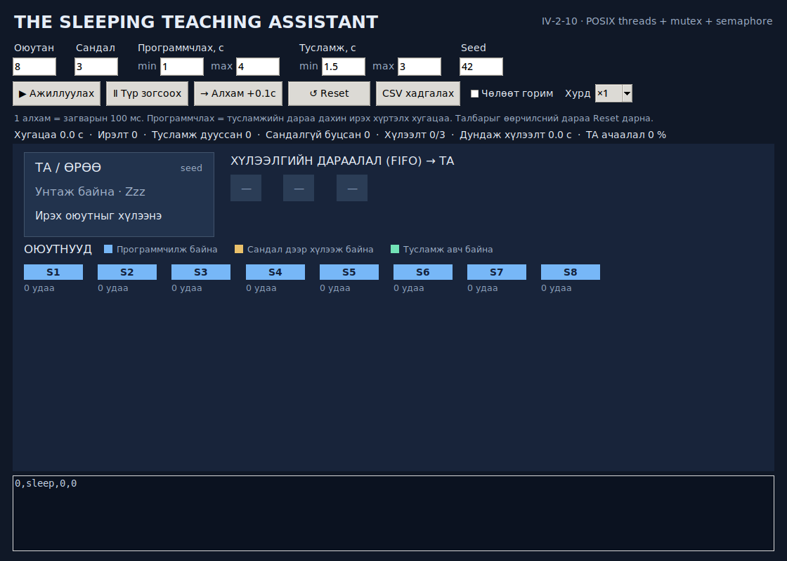
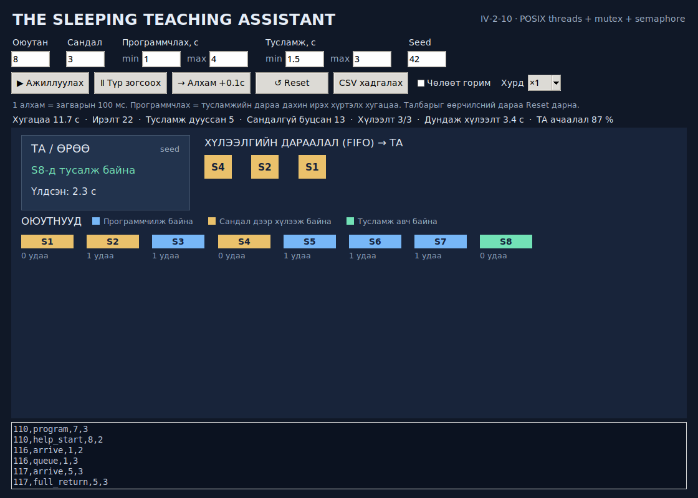
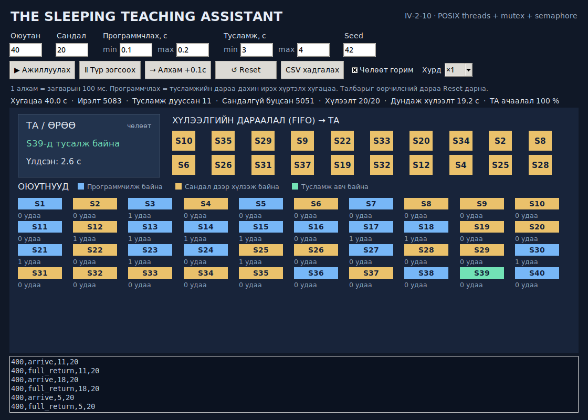
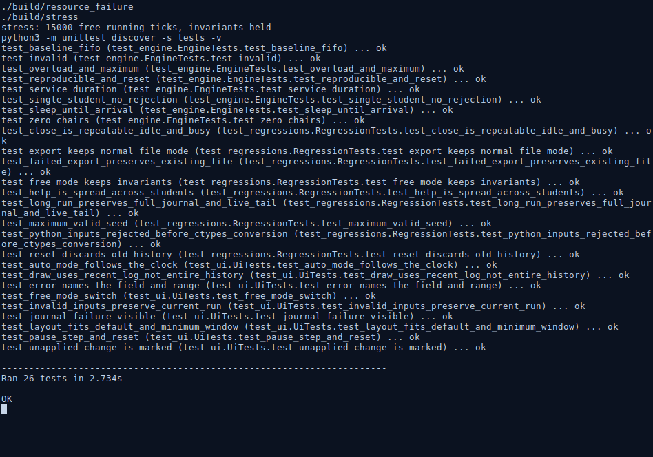
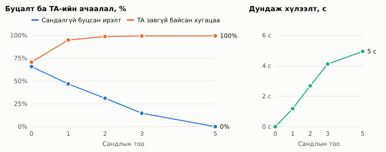

# The Sleeping Teaching Assistant — тайлан

IV-2-10 · F.CSM302 Үйлдлийн систем · Бие даалт 1 · хувилбар 1.1 (2026-11-13)

## Хураангуй

Operating System Concepts-ийн 7-р бүлгийн Project 2 “The Sleeping Teaching Assistant”-ийг C хэл
дээр POSIX thread, mutex, semaphore ашиглан хэрэгжүүлэв. TA болон 1–40 оюутан тус бүр тусдаа
thread. Сул TA semaphore дээр унтаж, ирсэн оюутан түүнийг сэрээнэ; TA завгүй бол оюутан 0–20
сандлын нэг дээр FIFO дарааллаар хүлээж, сандал дүүрэн бол программчилж байгаад дахин ирнэ.
Номын `sleep()`-ийн оронд 100 мс-ийн загварын цаг хэрэглэснээр Tkinter цонхоос туршилтыг
зогсоох, алхамчлах, seed-ээр яг давтах боломжтой болсон; “чөлөөт горим” нь оюутнуудыг нэг
tick дотор бодитоор зэрэг ажиллуулж синхрончлолыг шалгана.

Хувилбар 1.1 нь дотоод шүүмжийн 12 асуудлыг засав. 26 Python тест, 2 C тест, ThreadSanitizer
бүгд амжилттай. Гол үр дүн: (1) чөлөөт горимд 15 000 tick-д дүрэм зөрчигдөөгүй, mutex-ийг
авбал TSan race илрүүлж дүрэм эхний tick-д эвдэрнэ; (2) тусламжийн хуваарилалтын алдааг
засаж, урт туршилтад тусламж авсан оюутан 40-өөс 4 байсныг 37 болгов; (3) сандлын тоо
нэмэгдэхэд буцалт 65.9 %-иас 0 % хүртэл буурч, дундаж хүлээлт 0-ээс 4.95 с хүртэл өсдөг.

## 1. Удиртгал

Олон thread нэг нөөцийг (энд нэг TA, хязгаартай сандал) хуваалцахад зохицуулалт хэрэгтэй:
хамтын өгөгдөлд зэрэг хандвал race condition, буруу дарааллаар хүлээвэл deadlock, зарим thread
хэзээ ч нөөц авахгүй байвал starvation үүснэ. Sleeping TA бол эдгээрийг жижиг хэмжээнд
харуулдаг сонгодог бодлого. Төслийн зорилго: (1) номын шаардлагыг бодит thread, mutex,
semaphore-оор хэрэгжүүлэх, (2) оюутны тоо, сандал, хугацааг сольж туршиж болох интерактив UI
хийх, (3) зөв ажиллагааг тест болон тоон туршилтаар нотлох. Хамрах хүрээ: нэг TA, 1–40
оюутан, 0–20 сандал. CPU scheduler-ийн гүйцэтгэл хэмжих зорилгогүй.

## 2. Сурах бичгийн шаардлага

| Шаардлага (Project 2) | Хэрэгжилт |
|---|---|
| Оюутан бүр, TA тусдаа thread | `pthread_create`: TA 1, оюутан n (1–40) |
| Оюутан программчлах, тусламж хүсэх хооронд санамсаргүй хугацаа | Программчлах min–max, тусламж min–max (0.1–600 с), seed-тэй LCG |
| Оюутан байхгүй бол TA унтана | TA `work` semaphore дээр `sem_wait` хийж блоклогдоно |
| Ирсэн оюутан унтаж буй TA-г сэрээнэ | Оюутан `sem_post(&work)` |
| TA завгүй бол сандалд суух, сандал дүүрэн бол дараа ирэх | FIFO дараалал (≤ сандлын тоо), дүүрэн бол `full_return` |
| Сандал дээрх оюутан ээлжээ хүлээнэ | Оюутан `called[i]` дээр блоклогдоно; TA дуудна |
| Тусламж дуусахад TA дараагийнхыг авна, хоосон бол унтана | `done[i]` → оюутан буцна; TA `queue[0]`-г дуудах эсвэл `work` дээр унтах |
| Mutex, semaphore ашиглах | `pthread_mutex_t mu` + 5 нийтлэг, 3n оюутны semaphore |
| Анх 3 сандал | Өгөгдмөл тохиргоо 3 сандал |

## 3. Онолын үндэс

**Thread ба race condition.** Нэг процессын thread-үүд санах ойг хуваалцана. Хоёр thread нэг
хувьсагчийг зохицуулалтгүй уншиж, өөрчилбөл үр дүн гүйцэтгэлийн дарааллаас хамаарна. Энд
хамтын өгөгдөл нь дараалал (`queue`, `waiting_count`), TA-ийн төлөв (`current`, `remaining`),
оюутны төлөв, тоолуур, санамсаргүй тооны төлөв.

**Mutex.** `pthread_mutex_t mu` нь дээрх өгөгдлийг өөрчлөх хэсэгт нэг thread л нэвтрэхийг
баталгаажуулна. Жишээ нь хоёр оюутан зэрэг ирээд сүүлийн нэг сандлыг хоёулаа авах race-ийг
хаана.

**Semaphore.** Тоологч бүхий дохио: `sem_wait` тоолуур 0 үед thread-ийг блоклож, `sem_post`
нэмэгдүүлж хүлээж буй thread-ийг сэрээнэ. Энэ нь “унтах/сэрэх”-ийг busy-wait-гүйгээр
хэрэгжүүлнэ: сул TA, сандал дээрх оюутан, тусламж авч буй оюутан CPU хэрэглэхгүй хүлээнэ.

**Deadlock-оос сэргийлэх.** Thread semaphore дээр хүлээхээсээ өмнө mutex-ээ суллана. Mutex
барьсаар хүлээвэл дохио өгөх ёстой thread mutex авч чадахгүй гацна.

**FIFO ба шударга байдал.** Сандал дээр суусан оюутныг ирсэн дарааллаар нь дуудна. Сандалгүй
буцсан оюутанд тодорхой хугацаанд тусламж авах баталгаа номын шийдэлд ч байхгүй; хэн дараа нь
түрүүлж ирэхийг OS scheduler шийднэ. Тиймээс загвар нь оюутнуудын дарааллыг тогтмол биш,
санамсаргүй байлгах ёстой (5.3, 8.3).

## 4. Системийн зохиомж

Өгөгдлийн урсгал: **Tkinter (`app.py`) → `model.py` (ctypes) → `libta.so` (`engine.c`) → TA
ба n оюутны thread**. Буцах урсгал: C snapshot (JSON) → UI. UI дараалал, тусламжийн үр дүнг
өөрөө тооцохгүй, зөвхөн хөдөлгүүрийн төлөвийг зурна.

| Файл | Үүрэг |
|---|---|
| `src/engine.c` | Thread, mutex, semaphore, FIFO, загварын цаг, журнал, экспорт |
| `src/model.py` | ctypes интерфейс, оролт шалгах, CSV-г аюулгүй солих |
| `src/app.py` | Тохиргоо, удирдлага, дүрслэл, бодит цагтай автомат горим |
| `tests/` | Хөдөлгүүр, regression, UI, нөөцийн алдаа, чөлөөт горимын stress тест |
| `docs/experiments.py` | 8-р хэсгийн туршилт ба график |

| Semaphore | Хэн хүлээнэ | Хэн дохио өгнө | Утга |
|---|---|---|---|
| `work` | TA | анх ирсэн оюутан | Унтаж буй TA-г сэрээх |
| `started` | ирсэн оюутан | TA | Тусламж эхэлсэн |
| `called[i]` | сандал дээрх оюутан i | TA | Ээлж ирлээ |
| `done[i]` | тусламж авч буй оюутан i | TA | Тусламж дууслаа |
| `returned` | TA | оюутан i | Оюутан программчлалдаа буцлаа |
| `ticks[i]`, `ta_tick`, `ack` | worker | удирдагч | 100 мс-ийн загварын цаг |

Оюутны төлөв: **программчлах → (сандал дээр хүлээх) → тусламж авах → программчлах**.
TA-ийн төлөв: **унтах → туслах → дараагийнхад туслах эсвэл унтах**. Дараалал нь 40 элементийн
массив, бодит хязгаар нь сандлын тоо (≤ 20).

## 5. Хэрэгжилт

### 5.1 Оюутан ба TA

```text
student i:                                  TA:
  loop                                        loop
    wait ticks[i]          (программчлах)       wait work               (унтах)
    lock mu                                      lock; begin_help(current); unlock
    if now >= due[i]:  arrive                    post started
      TA сул   -> current = i                    loop every tick
      сул сандал -> queue.push(i)                  lock; remaining--; unlock
      эс бөгөөс -> full_return, due = now+r        if remaining == 0:
    unlock                                           post done[current]; wait returned
    TA сул:     post work; wait started              lock
    post ack                                         queue хоосон биш -> next = queue.pop
    сандалд суусан: wait called[i]                                       begin_help(next)
    wait done[i]           (тусламж)                 эс бөгөөс -> current = -1 (унтах)
    lock; state = программчлах; due = now+r          unlock; post called[next]
    unlock; post returned                          post ack
```

Mutex-ийг бүх хамтын өгөгдлийн өөрчлөлтөд барьж, `sem_wait`, `sem_post`-оос өмнө суллана.

### 5.2 Загварын цаг ба хоёр горим

`sim_step()` нь нэг tick (100 мс): `now++`, TA туслаж байвал `ta_tick` өгч `ack`-ийг хүлээнэ,
дараа нь программчилж буй оюутнуудад `ticks[i]` өгнө. Сандал дээрх болон тусламж авч буй
оюутан tick авахгүй — тэд `called[i]`, `done[i]` дээр блоклогдсон байна.

- **Seed горим:** оюутнуудыг нэг нэгээр нь ажиллуулж `ack` хүлээнэ. Үр дүн seed-ээр яг давтагдана.
- **Чөлөөт горим:** бүх программчилж буй оюутанд зэрэг `ticks[i]` өгч, дараа нь бүх `ack`-ийг
  хүлээнэ. Оюутнууд TA, сандал, mutex-ийн төлөө бодитоор өрсөлдөнө.

### 5.3 Тусламжийн шударга хуваарилалт

Оюутнуудын tick авах дарааллыг tick бүр seed-тэй тусдаа LCG-ээр Fisher–Yates аргаар холино.
Хувилбар 1.0 тогтмол `(k + now) % n` дараалал ашигладаг байсан тул TA сулрах tick нь
тусламжийн хугацааны алхмаар давтагдахад үргэлж ижил оюутнууд түрүүлдэг байв (8.3). Мөн LCG-ийн
сул доод битийн оронд дээд 16 битийг ашиглана.

### 5.4 Журнал, оролт, экспорт

`record_event` бүх үйл явдлыг түр файлд, сүүлийн 6-г UI-ийн буферт бичнэ. `Model.reset` нь
ctypes-д дамжуулахаас өмнө төрөл, хязгаар, min ≤ max-ийг шалгадаг (4294967297 → 1 болох
эрсдэлийг хаана); UI алдаатай талбарын нэр, хязгаарыг бичиж тухайн талбарыг сонгоно. CSV-г
түр файлд бичээд амжилттай бол `os.replace`-ээр сольж, файлын эрхийг хадгална. Нөөц
үүсгэхэд алдаа гарвал хэсэгчлэн үүссэн thread, semaphore-ийг цэвэрлэнэ.

### 5.5 UI

Автомат горим `time.monotonic()`-оор хугацааг хэмжиж, загварын цагийг бодит цаг × хурдтай
тэнцүү байлгана (зурах хугацаанаас үл хамаарна). Цонхны хэмжээ багасахад зөвхөн canvas
жижгэрч, тайлбар, төлөвийн мөр, лог үргэлж харагдана.

## 6. Туршилт ба UI дүрслэл

Хэрэглэгч оюутан, сандал, программчлах ба тусламжийн хугацаа, seed, горим, хурдыг сольж
дараах зүйлсийг ажиглана: TA унтах/сэрэх, сандал дүүрэх, FIFO дараалал, буцалт, тусламжийн
тоо, дундаж хүлээлт, TA-ийн ачаалал, CSV журнал.



*Зураг 1. Эхлэх цонх (8 оюутан, 3 сандал, seed 42, tick 0): TA унтаж, бүх оюутан программчилж
байна. Талбарын доор нэгж ба Reset-ийн тайлбар, оюутны мөрөнд өнгөний тайлбар харагдана.*



*Зураг 2. Ижил тохиргоо, 117 удаа “Алхам” (11.7 с): TA S8-д тусалж (2.3 с үлдсэн), сандал
дээр S4, S2, S1 ирсэн дарааллаараа хүлээж байна. Ирэлт 22 = буцсан 13 + дууссан 5 + хүлээж
буй 3 + туслуулж буй 1.*



*Зураг 3. 40 оюутан, 20 сандал, программчлах 0.1–0.2 с, тусламж 3–4 с, чөлөөт горим, 40 с:
20 сандал бүгд дүүрэн, TA-ийн ачаалал 100 %, ирэлтийн ихэнх нь буцна.*

## 7. Туршилтын арга

| Зүйл | Утга |
|---|---|
| OS | Ubuntu 26.04.1 LTS, Linux 7.0.0, x86_64 (AMD Ryzen 9 6900HS, 16 урсгал) |
| Compiler, runtime | gcc 15.2.0 (`-Wall -Wextra -Wpedantic -Werror`), Python 3.14.4, Tk 8.6.17 |
| CI | GitHub Actions `ubuntu-latest`: build, Xvfb-тэй тест, ThreadSanitizer |
| Гаралт | `docs/test-results.txt` |

1. **Хөдөлгүүрийн тест (8).** Tick бүрт: дараалал ≤ сандал, давхардалгүй, туслуулж буй
   оюутан дараалалд байхгүй, тусламж авч буй ≤ 1, хүлээж буй = дарааллын урт, баланс
   *ирэлт = буцсан + дууссан + хүлээж буй + туслуулж буй*. FIFO, тусламжийн хугацаа, унтах/
   сэрэх, seed-ээр давтагдах, буруу оролтыг журналтай тулгана.
2. **Regression тест (9).** Том тоо/bool/float оролт, max seed, 1.4 MB журнал, экспорт
   (алдаа, файлын эрх), reset, close, тусламжийн хуваарилалт, чөлөөт горимын дүрэм.
3. **UI тест (9).** Pause/step/reset, буруу оролт, лог, дискний алдаа, цонхны хэмжээ, талбарын
   нэртэй алдаа, Reset-ийн тэмдэг, бодит цагтай автомат горим (хуурамч цагаар), горимын товч.
4. **C тест.** `resource_failure`: TA thread, оюутны thread, semaphore үүсгэх алдааг зориуд
   өдөөнө. `stress`: чөлөөт горимд 5 тохиргоо × 3000 tick, tick бүрт дүрмийг C талд шалгана;
   `make tsan` нь ижил тестийг ThreadSanitizer-тэй ажиллуулна.
5. **Тоон туршилт** (`docs/experiments.py`). 6 оюутан, программчлах 2–8 с, тусламж 1–3 с,
   сандал 0–5; seed 1–5 тус бүр 6000 tick (10 мин); дундажийг авав.

## 8. Үр дүн

### 8.1 Тест

| Шалгалт | Хамрах зүйл | Үр дүн |
|---|---|---|
| `make` | `-Werror`-тэй build | Анхааруулга 0 |
| `xvfb-run -a make test` | C 2 + Python 26 тест | Бүгд OK (3.1 с) |
| `make tsan` | Чөлөөт горим, 5000 tick | Data race 0 |
| Дэлгэцгүй `make test` | 17 OK, UI 9 SKIP | OK |
| GitHub Actions | Push бүрд | Ногоон |



*Зураг 4. `make test` бодит терминалд: stress тест 15 000 tick, 26 unittest OK.*

### 8.2 Сандлын тоо ба үр ашиг

| Сандал | Буцалт, % | Дундаж хүлээлт, с | TA ачаалал, % | Тусламж / мин |
|---:|---:|---:|---:|---:|
| 0 | 65.9 | 0.00 | 70.8 | 21.4 |
| 1 | 46.8 | 1.19 | 95.0 | 28.2 |
| 2 | 31.1 | 2.69 | 98.9 | 29.7 |
| 3 | 14.8 | 4.12 | 99.4 | 29.7 |
| 5 | 0.0 | 4.95 | 99.5 | 29.8 |



*Зураг 5. Сандлын тоо (6 оюутан, 5 seed-ийн дундаж): зүүн — буцалт ба TA-ийн ачаалал,
баруун — сандал дээр хүлээсэн дундаж хугацаа.*

### 8.3 Тусламжийн хуваарилалт (1010 tick, seed 42)

| Тохиргоо | v1.0: авсан оюутан | v1.0: бага / медиан / их | v1.1: авсан оюутан | v1.1: бага / медиан / их |
|---|---:|---:|---:|---:|
| Урт туршилт: 40 / 0, 0.1 с, 1 с | 4 / 40 | 0 / 0 / 25 | 37 / 40 | 0 / 2 / 6 |
| Ачаалал: 20 / 3, 0.1–0.2 с, 3–4 с | 18 / 20 | 0 / 1 / 3 | 19 / 20 | 0 / 1 / 3 |
| Ердийн: 8 / 3, 1–4 с, 1.5–3 с | 8 / 8 | 3 / 5 / 7 | 8 / 8 | 5 / 6 / 6 |

### 8.4 Seed горим ба чөлөөт горим

| Хэмжүүр | Seed горим | Чөлөөт горим |
|---|---|---|
| Ижил seed, 3 ажиллуулалтын журналын hash | 1 ялгаатай (яг давтагдана) | 3 ялгаатай |
| Mutex-ийн хүлээсэн lock (60 000 tick) | 159 / 1 129 638 (0.01 %) | 224 993 / 1 129 642 (19.9 %) |
| Mutex-гүйгээр (`-DNO_MUTEX`) TSan | — | Data race, дүрэм эхний tick-д эвдэрсэн |
| `sim_step`, 40 оюутан | 313 µs | 60 µs |

Автомат горим: 10 с бодит хугацаанд ×1 → 9.9 с, ×20 → 199 с загварын цаг (v1.0: 0.90×).

## 9. Хэлэлцүүлэг

**Сандал.** Сандал нэмэхэд буцалт буурч, TA-ийн ачаалал 71 %-иас 99.5 % хүртэл өсч, нэг
минутад туслах тоо 21-ээс 30 болно. Үнэ нь хүлээлт: 3 сандалтай үед дундаж 4.1 с. 6 оюутантай
үед 5 сандал = бүх боломжит хүлээгч тул буцалт 0. Иймээс сандал TA-ийн сул зогсолтыг хаана,
харин TA-ийн хүчин чадлаас (≈ 30 тусламж/мин) илүү гаргахгүй.

**Шударга байдал.** v1.0-ийн тогтмол дараалал Урт туршилтад 36 оюутныг огт тусламжгүй
орхисон нь номын бодлогын шинж биш, хэрэгжилтийн алдаа байв: 0 сандал, тогтмол хугацаатай үед үйлчлүүлэх
оюутны тоо яг n / gcd(n, тусламжийн tick) байсан. Санамсаргүй дарааллаар 37 / 40 болсон; үлдсэн 3 нь 101 с-д
100 тусламж 40 оюутанд санамсаргүй хуваарилагдсаны үр дүн (хүлээгдэх утга ≈ 37).

**Синхрончлол.** Seed горимд worker-ууд ээлжлэн ажилладаг тул mutex дээр өрсөлдөөн бараг
үүсдэггүй (0.01 %); энэ горим давтагдах, тайлбарлах зориулалттай. Чөлөөт горимд lock-ийн
20 % өрсөлдөж, mutex-ийг авахад TSan race илрүүлж дүрэм эхний tick-д эвдэрсэн нь mutex
шаардлагатайг, харин mutex-тэй үед 15 000 tick-д зөрчил гараагүй нь протокол зөв болохыг
харуулна.

**Хязгаарлалт.** (1) `sleep()`-ийн оронд загварын цаг: хугацаа tick-ийн нарийвчлалтай (0.1 с).
(2) Чөлөөт горимд ч tick-ийн хил дээр бүх worker зогсдог; tick дотор л зэрэг ажиллана.
(3) Сандалгүй буцсан оюутанд хугацааны баталгаа байхгүй. (4) Тоолуур `int`, API-г нэг
удирдах thread дуудна. (5) WSL2-д туршаагүй.

## 10. Дүгнэлт

Номын бүх шаардлагыг бодит thread, mutex, semaphore-оор хэрэгжүүлж, сандал дээрх болон
тусламж авч буй оюутныг semaphore дээр блоклож, сул TA-г унтуулав. Интерактив UI нь
тохиргоог сольж, алхамчилж, бодит цагаар эсвэл хурдасгаж ажиглах, CSV-ээр дахин шалгах
боломж олгоно. Зөв ажиллагааг 28 автомат тест, чөлөөт горимын stress тест, ThreadSanitizer,
тоон туршилтаар нотлов. Хувилбар 1.1 нь тусламжийн хуваарилалт, synchronization протокол,
UI-ийн дүрслэл ба цаг, баримтын нийцлийг засав.

## 11. GitHub ба хувилбар

- Repository: <https://github.com/mendamgalan/IV-2-10-sleeping-ta>; салбар `main`, гишүүдийн
  `mendamgalan`, `orgil-sandbox` салбараас pull request (#1–#3)-ээр нэгтгэсэн.
- GitHub Actions push, pull request бүрд build, Xvfb-тэй тест, ThreadSanitizer ажиллуулна.
- `v1.0` — БД1 постын хувилбар (`ec353b0`, 2026-10-26). `v1.1` — энэ тайлангийн хувилбар.
- Commit түүх: `git log --oneline`, гишүүдийн commit: `git shortlog -sn` (`.mailmap`-тай).

**v1.1-ийн засвар (дотоод шүүмжийн 12 асуудал):**

| № | Асуудал | Засвар |
|---|---|---|
| 1 | Тогтмол дараалал тусламжийг цөөн оюутанд төвлөрүүлнэ | Tick бүр seed-тэй холих (5.3, 8.3) |
| 2 | Synchronization бодитоор шалгагдахгүй | `called[i]`, `done[i]`, `returned`; чөлөөт горим, stress, TSan (8.4) |
| 3 | Доод тайлбар харагдахгүй, 40 оюутан багтахгүй | Шинэ layout, өнгөт тэмдэг, UI тест |
| 4 | “Дууссан” төлөв хэзээ ч харагдахгүй | Төлөвийг хасав |
| 5 | Автомат горим 10 % удаан | Бодит цагт суурилсан, ×1/×5/×20 |
| 6 | Тайлан, баримт хоорондоо зөрнө | Report.md-ээс PDF үүсгэх (`make docs`), шинэ зураг, тест гаралт |
| 7 | Тайлангийн бүтэц дутуу | Хэлэлцүүлэг, тоон туршилт, GitHub хэсэг |
| 8 | Release/Tag байхгүй | `v1.0`, `v1.1` tag |
| 9 | Алдааны мессеж ерөнхий | Талбарын нэр, хязгаар; талбарыг сонгоно |
| 10 | CSV 0600 эрхтэй | Эрхийг хадгална |
| 11 | Дундаж хүлээлт, ачаалал, хурд байхгүй | Төлөвийн мөр, хурдны сонголт, Reset-ийн тэмдэг |
| 12 | Давхар нэр, Manual-д хувилбар, шошго | `.mailmap`, Manual 1, “Программчлах, с” |

## Ашигласан материал

1. A. Silberschatz, P. B. Galvin, G. Gagne. *Operating System Concepts*, 10th ed., Chapter 7,
   Programming Project 2 — The Sleeping Teaching Assistant.
2. F.CSM302 — OS_BD1_Guide.pdf, OS_Peer_Review_Guide.pdf.
3. POSIX: `pthread_create(3)`, `pthread_mutex_lock(3)`, `sem_init(3)`, `sem_wait(3)`, `sem_post(3)`.
4. Python: `tkinter`, `ctypes` баримт бичиг; GCC ThreadSanitizer.
5. AI хэрэглээ: OpenAI ChatGPT (v1.0 код, тест, баримт бичиг), Claude (v1.1-ийн дотоод шүүмж,
   засвар, тайлан). Бүх үр дүнг баг өөрсдийн машин дээр ажиллуулж шалгав.
