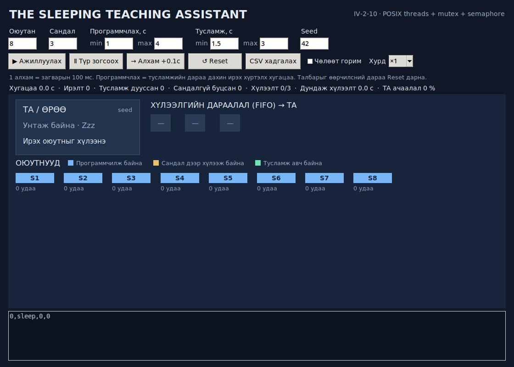
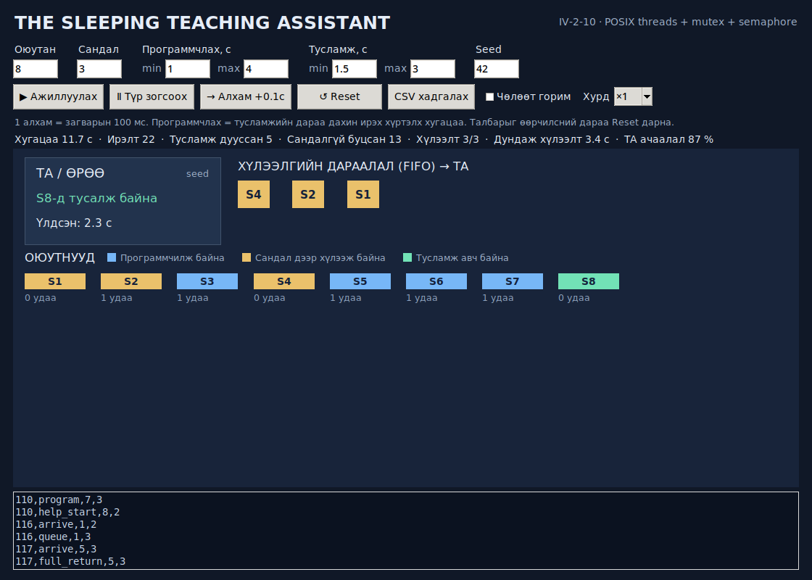
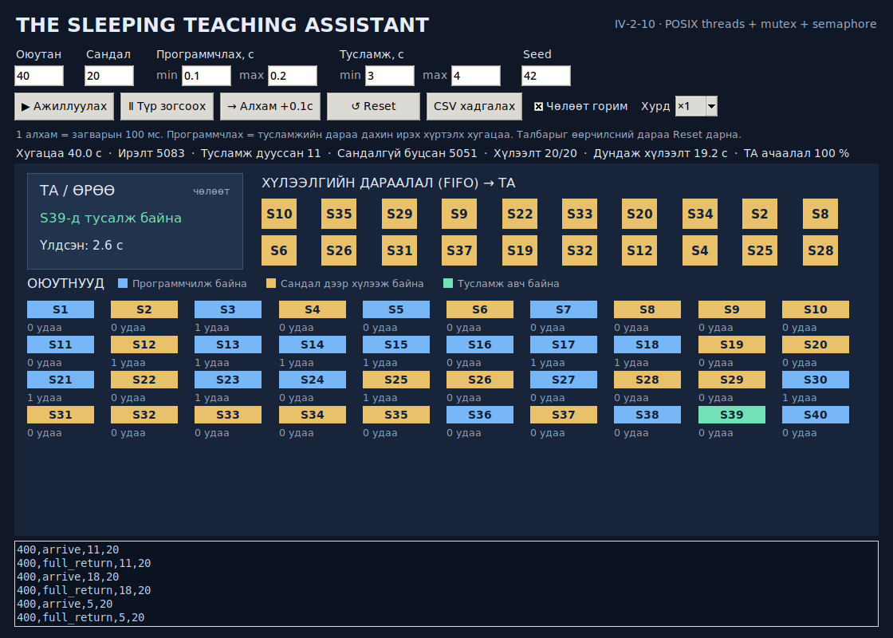
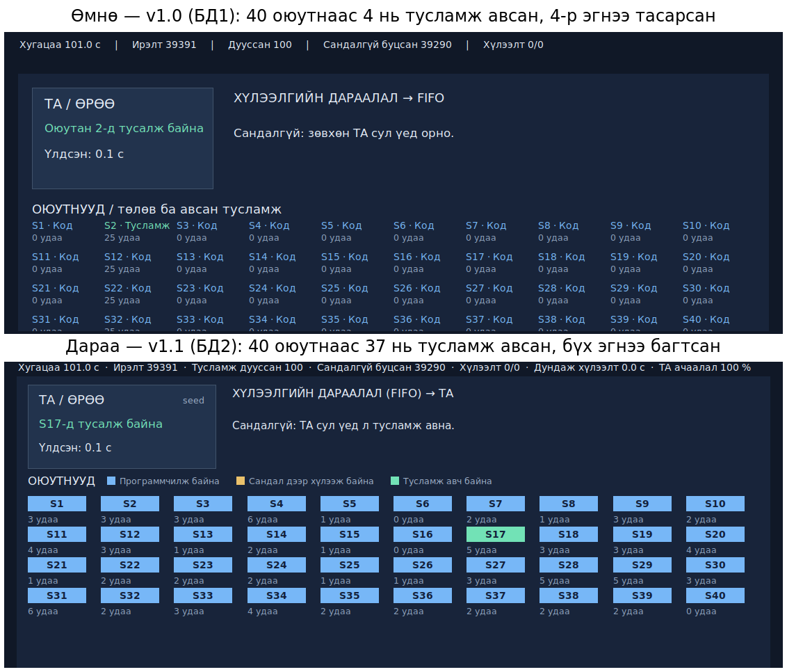
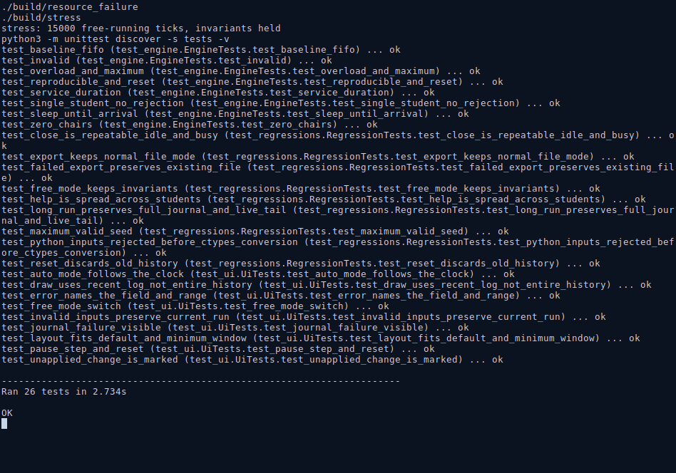
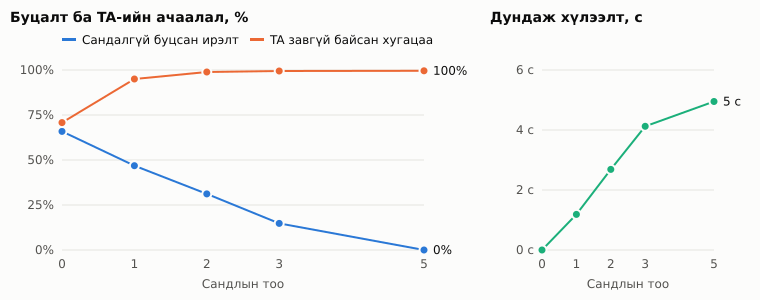

# The Sleeping Teaching Assistant — Final Report

IV-2-10 · F.CSM302 Үйлдлийн систем · Бие даалт 2 · Final Report · final release v1.2 (2026-11-19)

## Хураангуй

**Эцсийн шийдэл.** Operating System Concepts-ийн 7-р бүлгийн Project 2 “The Sleeping Teaching
Assistant”-ийг C хэл дээр POSIX thread, mutex, semaphore-оор хэрэгжүүлэв. TA болон 1–40 оюутан
тус бүр тусдаа thread. Сул TA semaphore дээр унтаж, ирсэн оюутан сэрээнэ; TA завгүй бол оюутан
0–20 сандлын нэг дээр FIFO дарааллаар хүлээж, сандал дүүрэн бол программчилж байгаад дахин
ирнэ. Tkinter цонх нь C хөдөлгүүрийн төлөвийг шууд зурж, туршилтыг алхамчлах, seed-ээр яг
давтах, “чөлөөт горимоор” оюутнуудыг бодитоор зэрэг өрсөлдүүлэх боломжтой.

**Гол сайжруулалт.** БД1-ийн хувилбар 1.0-д хийсэн дотоод шүүмжийн 12 саналаас 11-ийг бүрэн,
1-ийг хэсэгчлэн хэрэгжүүлэв (4-р хэсэг): тусламжийн шударга хуваарилалт, оюутныг semaphore
дээр бодитоор блоклох протокол, чөлөөт горим ба ThreadSanitizer, UI-ийн дүрслэл ба бодит цаг,
талбарын нэртэй алдааны мессеж, баримтын нийцэл.

**Үр дүн.** 26 Python тест, 2 C тест, ThreadSanitizer амжилттай; хуучин 18 тест өөрчлөлтгүй
давсан. Урт туршилтад тусламж авсан оюутан 40-өөс 4 байсныг 37 болгов. Чөлөөт горимд 15 000
tick-д дүрэм зөрчигдөөгүй, mutex-ийг авахад TSan race илрүүлж дүрэм эхний tick-д эвдэрсэн.
Сандал 0 → 5 болоход буцалт 65.9 %-иас 0 % хүртэл буурч, дундаж хүлээлт 0-ээс 4.95 с болж өсөв.

## 1. Төслийн тойм

### 1.1 Номын шаардлага ба хэрэгжилт

| Шаардлага (Project 2) | Хэрэгжилт |
|---|---|
| Оюутан бүр, TA тусдаа thread | `pthread_create`: TA 1, оюутан n (1–40) |
| Программчлах, тусламж хүсэх хооронд санамсаргүй хугацаа | Программчлах ба тусламж min–max (0.1–600 с), seed-тэй LCG |
| Оюутан байхгүй бол TA унтана | TA `work` semaphore дээр `sem_wait` хийж блоклогдоно |
| Ирсэн оюутан унтаж буй TA-г сэрээнэ | Оюутан `sem_post(&work)` |
| TA завгүй бол сандалд суух, дүүрэн бол дараа ирэх | FIFO дараалал (≤ сандлын тоо), дүүрэн бол `full_return` |
| Сандал дээрх оюутан ээлжээ хүлээнэ | Оюутан `called[i]` дээр блоклогдоно; TA дуудна |
| Тусламж дуусахад дараагийнхыг авах, хоосон бол унтах | `done[i]` → оюутан буцна; TA `queue[0]`-г дуудах эсвэл `work` дээр унтах |
| Mutex, semaphore ашиглах | `pthread_mutex_t mu` + 5 нийтлэг, 3n оюутны semaphore |
| Анх 3 сандал | Өгөгдмөл тохиргоо 3 сандал |

### 1.2 OS ойлголт

Нэг процессын thread-үүд санах ойг хуваалцдаг тул дараалал (`queue`, `waiting_count`), TA-ийн
төлөв (`current`, `remaining`), оюутны төлөв, тоолуурт зэрэг хандвал race condition үүснэ —
жишээ нь хоёр оюутан сүүлийн сандлыг зэрэг авах. **Mutex** эдгээрийг өөрчлөх хэсэгт нэг thread
л нэвтрэхийг баталгаажуулна. **Semaphore** нь тоологч бүхий дохио: `sem_wait` 0 үед thread-ийг
блоклож, `sem_post` сэрээнэ — сул TA, сандал дээрх, тусламж авч буй оюутан CPU хэрэглэхгүй
хүлээнэ. Thread semaphore дээр хүлээхээсээ өмнө mutex-ээ суллаж **deadlock**-оос сэргийлнэ.
Сандалгүй буцсан оюутанд тусламж авах хугацааны баталгаа номын шийдэлд ч байхгүй тул
**starvation**-ийг оюутны санамсаргүй дарааллаар багасгана.

### 1.3 БД1-ээс БД2 хүртэл

| Хувилбар | Агуулга |
|---|---|
| v1.0 (`ec353b0`) | БД1-ийн пост: C хөдөлгүүр, Tkinter UI, 18 Python + 1 C тест, БД1 тайлан |
| Дотоод шүүмж | Шинэ clone дээр Manual-ийн дагуу дахин туршиж 12 санал гаргав (4-р хэсэг) |
| v1.1 | Шүүмжийн засвартай код, тест, баримт |
| v1.2 | Final release: v1.1-ийн код + энэ Final Report, Poster, Manual (кодын өөрчлөлтгүй) |

## 2. Эцсийн архитектур

Өгөгдлийн урсгал: **Tkinter (`app.py`) → `model.py` (ctypes) → `libta.so` (`engine.c`) → TA
ба n оюутны thread**; буцах урсгал: C snapshot (JSON) → UI. UI дараалал, тусламжийн үр дүнг
өөрөө тооцохгүй, зөвхөн хөдөлгүүрийн төлөвийг зурна.

### 2.1 Өөрчлөгдсөн компонент

| Компонент | v1.0 | Эцсийн (v1.1) |
|---|---|---|
| `engine.c`: оюутны дараалал | Тогтмол `(k + now) % n` | Tick бүр seed-тэй Fisher–Yates холино |
| `engine.c`: сандал дээрх оюутан | Блоклогддоггүй; TA `queue[0]`-г шууд авна | `called[i]` дээр блоклогдож, TA дуудна |
| `engine.c`: тусламж авч буй оюутан | `done[i]`-г tick бүр `sem_trywait`-аар шалгана | `done[i]` дээр блоклогдож, `returned`-аар TA-д буцна |
| `engine.c`: горим | Зөвхөн ээлжлэх | Seed горим + чөлөөт горим (`sim_set_free`) |
| `model.py` | CSV 0600 эрхтэй болдог | Файлын эрхийг хадгална; `advance()`, `free` |
| `app.py` | Тайлбар, 40 оюутан багтдаггүй; 0.90× цаг | Шинэ layout, бодит цаг ×1/×5/×20, талбарын нэртэй алдаа |
| `tests/` | 18 Python + `resource_failure.c` | + 8 Python тест, `stress.c`, `make tsan`, CI-д TSan |
| `docs/` | Report.md ба PDF зөрсөн | Report.md, Manual.md-ээс PDF (`make docs`), постер (`make poster`) |

### 2.2 Thread ба semaphore

| Semaphore | Хэн хүлээнэ | Хэн дохио өгнө | Утга |
|---|---|---|---|
| `work` | TA | анх ирсэн оюутан | Унтаж буй TA-г сэрээх |
| `started` | ирсэн оюутан | TA | Тусламж эхэлсэн |
| `called[i]` | сандал дээрх оюутан i | TA | Ээлж ирлээ |
| `done[i]` | тусламж авч буй оюутан i | TA | Тусламж дууслаа |
| `returned` | TA | оюутан i | Оюутан программчлалдаа буцлаа |
| `ticks[i]`, `ta_tick`, `ack` | worker | удирдагч | 100 мс-ийн загварын цаг |

Оюутны төлөв: **программчлах → (сандал дээр хүлээх) → тусламж авах → программчлах**.
TA-ийн төлөв: **унтах → туслах → дараагийнхад туслах эсвэл унтах**.

```text
student i:                                  TA:
  loop                                        loop
    wait ticks[i]          (программчлах)       wait work               (унтах)
    lock mu                                      lock; begin_help(current); unlock
    if now >= due[i]:  arrive                    post started
      TA сул   -> current = i                    loop every tick
      сул сандал -> queue.push(i)                  lock; remaining--; unlock
      эс бөгөөс -> full_return, due = now+r        if remaining == 0:
    unlock                                           post done[current]; wait returned
    TA сул:     post work; wait started              lock
    post ack                                         queue хоосон биш -> next = queue.pop
    сандалд суусан: wait called[i]                                       begin_help(next)
    wait done[i]           (тусламж)                 эс бөгөөс -> current = -1 (унтах)
    lock; state = программчлах; due = now+r          unlock; post called[next]
    unlock; post returned                          post ack
```

### 2.3 Загварын цаг ба хоёр горим

`sim_step()` нь нэг tick (100 мс): `now++`, TA туслаж байвал `ta_tick` өгч `ack`-ийг хүлээнэ,
дараа нь программчилж буй оюутнуудад `ticks[i]` өгнө; сандал дээрх, тусламж авч буй оюутан
semaphore дээр блоклогдсон тул tick авахгүй.

- **Seed горим:** оюутнуудыг холисон дарааллаар нэг нэгээр ажиллуулна; үр дүн seed-ээр яг давтагдана.
- **Чөлөөт горим:** бүх программчилж буй оюутанд зэрэг `ticks[i]` өгнө; оюутнууд TA, сандал,
  mutex-ийн төлөө бодитоор өрсөлдөж, хэн түрүүлэхийг OS шийднэ.

Бусад: бүтэн журнал түр файлд, UI-д сүүлийн 6 үйл явдал; `Model.reset` ctypes-д дамжуулахаас
өмнө төрөл, хязгаар, min ≤ max-ийг шалгана; нөөц үүсгэх алдаанд хэсэгчлэн үүссэн thread,
semaphore-ийг цэвэрлэнэ.

## 3. Туршилт ба дүрслэл

**Тохиргоо.** Оюутан (1–40), сандал (0–20), программчлах ба тусламжийн хугацаа (0.1–600 с),
seed, горим (seed / чөлөөт), хурд (×1 / ×5 / ×20). Талбарыг өөрчилсний дараа Reset дарна;
хэрэглэгдээгүй талбар `*` тэмдэгтэй.

**Ажиглалтын урсгал.**

1. Өгөгдмөл тохиргоо (8 оюутан, 3 сандал, seed 42): TA унтаж байна (Зураг 1).
2. Ажиллуулах: ирсэн оюутан TA-г сэрээж, бусад нь сандал дээр FIFO дарааллаар хүлээнэ (Зураг 2).
3. Түр зогсоох, Алхам: төлөв бүрийг 0.1 с-ээр шалгана; лог, CSV-д үйл явдал бүр бичигдэнэ.
4. Сандлын тоог 0 → 5 болгож буцалт, дундаж хүлээлт, TA-ийн ачааллыг харьцуулна (6.1).
5. Чөлөөт горим, 40 оюутан, 20 сандал: зэрэг өрсөлдөөн, сандал дүүрэх (Зураг 3).



*Зураг 1. Эхлэх цонх (8 оюутан, 3 сандал, seed 42, tick 0): TA унтаж, бүх оюутан программчилж
байна. Талбарын доор нэгж ба Reset-ийн тайлбар, оюутны мөрөнд өнгөний тайлбар харагдана.*



*Зураг 2. Ижил тохиргоо, 117 удаа “Алхам” (11.7 с): TA S8-д тусалж (2.3 с үлдсэн), сандал
дээр S4, S2, S1 ирсэн дарааллаараа хүлээж байна. Ирэлт 22 = буцсан 13 + дууссан 5 + хүлээж
буй 3 + туслуулж буй 1.*



*Зураг 3. 40 оюутан, 20 сандал, программчлах 0.1–0.2 с, тусламж 3–4 с, чөлөөт горим, 40 с:
20 сандал бүгд дүүрэн, TA-ийн ачаалал 100 %, ирэлтийн ихэнх нь буцна.*

## 4. Reviewer Responses

Шүүмжийн эх сурвалж: БД1-ийн v1.0-д хийсэн дотоод шүүмж (шинэ clone, Manual-ийн дагуу Build/Run,
18 үндсэн + 14 нэмэлт тест). Өөр багийн албан ёсны шүүмж, comment ирээгүй. Ангилал: Critical 0,
Major 0, Minor 9, Suggestion 3. Шийдвэр: 11 зөвшөөрсөн, 1 хэсэгчлэн, татгалзсан 0.

| № | Шүүмж | Priority | Шийдвэр | Өөрчлөлт ба нотолгоо |
|---|---|---|---|---|
| 1 | Оюутны тогтмол дараалал тусламжийг цөөн оюутанд төвлөрүүлнэ (Урт туршилтад 4 / 40) | Minor | Зөвшөөрсөн | Tick бүр seed-тэй холино, LCG-ийн дээд бит (`b4382c8`); `test_help_is_spread_across_students`; 37 / 40 (Зураг 4, 6.2) |
| 2 | Ээлжлэх загварт mutex/semaphore протокол бодитоор шалгагдахгүй; хязгаарлалт тайланд бичигдээгүй | Minor | Зөвшөөрсөн | `called[i]`, `done[i]`, `returned`, `sem_post(&work)` mutex-ийн гадна (`92cb403`); чөлөөт горим, `stress.c`, `make tsan`, CI (`662df2d`); өрсөлдөөн 19.9 %, mutex-гүй үед race (5, 6.3) |
| 3 | Өгөгдмөл цонхонд доод тайлбар харагдахгүй; 40 оюутантай үед шошго давхцаж, эгнээ тасарна | Minor | Зөвшөөрсөн | Шинэ layout, өнгөт тэмдэг (`33188aa`); `test_layout_fits_default_and_minimum_window`; Зураг 1–3 |
| 4 | “Дууссан” төлөв хэзээ ч харагдахгүй | Minor | Зөвшөөрсөн | Төлөвийг хасав (`92cb403`); төлөвийн машин 2.2 |
| 5 | Автомат горимын цаг 10 % удаан | Minor | Зөвшөөрсөн | `time.monotonic()`-д суурилсан, ×1 / ×5 / ×20 (`8b738f0`, `c779d16`); `test_auto_mode_follows_the_clock`; 0.90× → 0.995× |
| 6 | Тайлан, баримт хоорондоо ба кодтой зөрнө | Minor | Зөвшөөрсөн | Markdown-оос PDF (`31238f0`), шинэ screenshot (`66813af`), нэг тестийн гаралт (`54e77d7`, `de623f7`), туршилтын скрипт (`bc53091`) |
| 7 | Тайлангийн бүтэц дутуу: хэлэлцүүлэг, тоон туршилт, GitHub-ийн ажиллагаа | Minor | Зөвшөөрсөн | БД2-ын бүтэцтэй энэ Final Report: тоон туршилт (6), хязгаарлалт (7), Хавсралт А |
| 8 | Release/Tag байхгүй | Minor | Зөвшөөрсөн | `v1.0` (`ec353b0`), `v1.1`, final release `v1.2` = энэ тайлангийн commit |
| 9 | Алдааны мессеж аль талбар буруу болохыг заадаггүй | Minor | Зөвшөөрсөн | Талбарын нэр, хязгаар, талбарыг сонгоно; `*` тэмдэг (`761646e`); `test_error_names_the_field_and_range`, `test_unapplied_change_is_marked` |
| 10 | CSV экспорт файлын эрхийг 0600 болгодог | Suggestion | Зөвшөөрсөн | Эрхийг хадгална (`01187dc`); `test_export_keeps_normal_file_mode` |
| 11 | UI-д дундаж хүлээлт, ачаалал, хурдны удирдлага дутуу; лог 6 мөр | Suggestion | Хэсэгчлэн | Дундаж хүлээлт, TA ачаалал (`33188aa`), хурд (`8b738f0`), Reset тэмдэг (`761646e`). **Лог 6 мөрөөр үлдсэн:** бүтэн түүх CSV-д бий; илүү мөр нь 980×740 цонхонд canvas-ыг багасгаж 40 оюутан багтахгүй болгоно |
| 12 | Давхар нэр, Manual-д хувилбар, постын загвар, “Ирэх” шошго | Suggestion | Зөвшөөрсөн | `.mailmap` (`8d092dd`), Manual 1-д туршсан хувилбар (`6d6bb7e`), “Программчлах, с” шошго (`33188aa`), БД2-ын постын загвар |

## 5. Дахин туршилт

**Regression.** v1.0-ийн 18 Python тест ба `resource_failure` өөрчлөлтгүйгээр давсан; 8 шинэ
Python тест, `stress.c`, `make tsan` нэмэгдэв. Дотоод шүүмжийн 600 санамсаргүй тохиргооны
(~500 000 tick) шалгалтыг v1.1 дээр давтахад дүрмийн зөрчил 0. v1.0-ийн утгыг шүүмжийн үеэр
шинэ clone дээр хэмжсэн.

| Тест | Засварын өмнө (v1.0) | Засварын дараа (v1.1) | Дүгнэлт |
|---|---|---|---|
| `make test` (Python + C) | 18 + 1 OK | 26 + 2 OK | Хуучин тест бүгд давсан |
| 600 санамсаргүй тохиргоо | Зөрчил 0 | Зөрчил 0 | Зөв ажиллагаа хадгалагдсан |
| Урт туршилт: тусламж авсан оюутан | 4 / 40 | 37 / 40 | №1 засагдсан |
| Mutex lock өрсөлдөөн | 0.001 % | 0.01 % (seed), 19.9 % (чөлөөт) | Mutex бодитоор ажилладаг (№2) |
| Mutex-гүй үед TSan | Race 0 — mutex илүүц | Race, дүрэм 1-р tick-д эвдэрнэ | Mutex зайлшгүй (№2) |
| Чөлөөт горимын stress | Байхгүй | 15 000 tick, зөрчил 0 | Зэрэг ажиллагаа зөв |
| Автомат горим, 20 с бодит цаг | 18.0 с | 19.9 с | №5 засагдсан |
| Доод тайлбар, 40 оюутан | Харагдахгүй, тасарна | Харагдана, багтана | №3 засагдсан (UI тест) |
| 17 буруу оролт | “Буруу утга орууллаа.” | “Оюутан: 1–40 хүртэлх бүхэл тоо оруулна.” | №9 засагдсан |
| CSV экспортын эрх | `-rw-------` болно | Хадгална | №10 засагдсан |
| Нэг tick, 40 оюутан | 331 µs | 313 µs (seed), 60 µs (чөлөөт) | Гүйцэтгэл буураагүй |



*Зураг 4. Ижил тохиргоо (40 оюутан, 0 сандал, программчлах 0.1 с, тусламж 1 с, seed 42, 101 с):
дээр — v1.0, тусламжийг 4 оюутан авч, 4-р эгнээний тоо тасарсан; доор — v1.1, тусламж 37
оюутанд тархаж, бүх эгнээ, дундаж хүлээлт, TA-ийн ачаалал харагдана.*

| Шалгалт | Хамрах зүйл | Үр дүн |
|---|---|---|
| `make` | `-Werror`-тэй build | Анхааруулга 0 |
| `xvfb-run -a make test` | C 2 + Python 26 тест | Бүгд OK (3.1 с) |
| `make tsan` | Чөлөөт горим, 5000 tick | Data race 0 |
| Дэлгэцгүй `make test` | 17 OK, UI 9 SKIP | OK |
| GitHub Actions | Push бүрд | Ногоон |



*Зураг 5. `make test` бодит терминалд: stress тест 15 000 tick, 26 unittest OK.*

## 6. Эцсийн үр дүн

Туршилтыг `python3 docs/experiments.py`-аар давтана. Орчин: Ubuntu 26.04.1, gcc 15.2.0,
Python 3.14.4, Tk 8.6.17, AMD Ryzen 9 6900HS.

### 6.1 Сандлын тоо

6 оюутан, программчлах 2–8 с, тусламж 1–3 с; seed 1–5 тус бүр 6000 tick (10 мин), дундаж.

| Сандал | Буцалт, % | Дундаж хүлээлт, с | TA ачаалал, % | Тусламж / мин |
|---:|---:|---:|---:|---:|
| 0 | 65.9 | 0.00 | 70.8 | 21.4 |
| 1 | 46.8 | 1.19 | 95.0 | 28.2 |
| 2 | 31.1 | 2.69 | 98.9 | 29.7 |
| 3 | 14.8 | 4.12 | 99.4 | 29.7 |
| 5 | 0.0 | 4.95 | 99.5 | 29.8 |



*Зураг 6. Сандлын тоо (6 оюутан, 5 seed-ийн дундаж): зүүн — буцалт ба TA-ийн ачаалал,
баруун — сандал дээр хүлээсэн дундаж хугацаа.*

Сандал нэмэхэд буцалт буурч, TA-ийн ачаалал 71 %-иас 99.5 % хүртэл, нэг минутад туслах тоо
21-ээс 30 болно; үнэ нь хүлээлт (3 сандалтай үед 4.1 с). 6 оюутантай үед 5 сандал бол бүх
боломжит хүлээгч тул буцалт 0. Сандал TA-ийн сул зогсолтыг хаадаг ч TA-ийн хүчин чадлаас
(≈ 30 тусламж/мин) илүү гаргахгүй.

### 6.2 Тусламжийн хуваарилалт (1010 tick, seed 42)

| Тохиргоо | v1.0: авсан оюутан | v1.0: бага / медиан / их | v1.1: авсан оюутан | v1.1: бага / медиан / их |
|---|---:|---:|---:|---:|
| Урт туршилт: 40 / 0, 0.1 с, 1 с | 4 / 40 | 0 / 0 / 25 | 37 / 40 | 0 / 2 / 6 |
| Ачаалал: 20 / 3, 0.1–0.2 с, 3–4 с | 18 / 20 | 0 / 1 / 3 | 19 / 20 | 0 / 1 / 3 |
| Ердийн: 8 / 3, 1–4 с, 1.5–3 с | 8 / 8 | 3 / 5 / 7 | 8 / 8 | 5 / 6 / 6 |

v1.0-д 0 сандал, тогтмол хугацаатай үед тусламж авах оюутны тоо яг n / gcd(n, тусламжийн tick)
байсан нь хэрэгжилтийн алдаа байв. Үлдсэн 3 оюутан нь 101 с-д 100 тусламж 40 оюутанд
санамсаргүй хуваарилагдсаны үр дүн (хүлээгдэх утга ≈ 37).

### 6.3 Seed горим ба чөлөөт горим

| Хэмжүүр | Seed горим | Чөлөөт горим |
|---|---|---|
| Ижил seed, 3 ажиллуулалтын журналын hash | 1 ялгаатай (яг давтагдана) | 3 ялгаатай |
| Mutex-ийн хүлээсэн lock (60 000 tick) | 159 / 1 129 638 (0.01 %) | 224 993 / 1 129 642 (19.9 %) |
| Mutex-гүйгээр (`-DNO_MUTEX`) TSan | — | Data race, дүрэм эхний tick-д эвдэрсэн |
| `sim_step`, 40 оюутан | 313 µs | 60 µs |

Seed горимд worker-ууд ээлжлэн ажилладаг тул өрсөлдөөн бараг үүсдэггүй — давтах, тайлбарлах
зориулалттай. Чөлөөт горимд lock-ийн 20 % өрсөлдөж, mutex-гүй үед race илэрсэн нь mutex
шаардлагатайг, mutex-тэй үед 15 000 tick-д зөрчил гараагүй нь протокол зөв болохыг харуулна.
Автомат горим: 10 с бодит хугацаанд ×1 → 9.9 с, ×20 → 199 с загварын цаг.

## 7. Хязгаарлалт

| Орчин | Төлөв |
|---|---|
| Ubuntu 26.04.1, gcc 15.2.0, Python 3.14.4, Tk 8.6.17 | Туршсан (бүх тест, TSan) |
| GitHub Actions `ubuntu-latest` | Push бүрд build, тест, TSan |
| Debian | v1.0-д баг туршсан |
| Windows WSL2 + WSLg | Туршаагүй |
| Native Windows, macOS | Дэмжихгүй |

Үлдсэн асуудал:

1. Номын `sleep()`-ийн оронд 100 мс-ийн загварын цаг: хугацааны нарийвчлал 0.1 с.
2. Чөлөөт горимд ч tick-ийн хил дээр бүх worker зогсдог; зэрэг ажиллагаа tick дотор л явагдана.
3. Сандалгүй буцсан оюутанд тусламж авах хугацааны баталгаа байхгүй (номын шийдэлд ч байхгүй).
4. UI-ийн лог сүүлийн 6 үйл явдал; бүтэн түүхийг CSV-ээр харна (Шүүмж №11).
5. Тоолуур `int`, C API-г нэг удирдах thread дуудна; сар дамжин ажиллуулах зориулалтгүй.

## 8. Дүгнэлт

Номын Sleeping TA шийдлийг бодит thread, mutex, semaphore-оор хэрэгжүүлж, сандал дээрх болон
тусламж авч буй оюутныг semaphore дээр блоклож, сул TA-г унтуулав. Шүүмжийн дагуу тусламжийн
хуваарилалт, synchronization протокол, UI, баримтыг засаж, засварыг regression тест, stress
тест, ThreadSanitizer, тоон туршилтаар нотлов. Seed горим үр дүнг яг давтаж тайлбарлах, чөлөөт
горим бодит өрсөлдөөнийг харуулахад тохиромжтой.

**Суралцсан зүйл.** (1) Semaphore дээр бодитоор хүлээх нь polling-оос (tick бүр `sem_trywait`)
илүү зөв, CPU хэмнэлттэй. (2) Давтагдах загвар ба бодит зэрэг ажиллагаа хоёр өөр зорилготой —
хоёуланг нь хадгалах нь тайлбар ба нотолгоог хоёуланг өгнө. (3) Тест давсан нь synchronization
зөв гэсэн үг биш: mutex-ийг авахад тест давсаар байсныг ThreadSanitizer л илрүүлсэн.
(4) Тогтмол дараалал нуугдмал starvation үүсгэж болно. (5) Баримтыг нэг эх сурвалжаас үүсгэх
нь тайлан, Manual, код хооронд зөрүүгүй байлгана.

## Хавсралт А. GitHub ба багийн ажил

- Repository: <https://github.com/mendamgalan/IV-2-10-sleeping-ta>; салбар `main`, гишүүдийн
  `mendamgalan`, `orgil-sandbox` салбараас pull request-ээр нэгтгэсэн.
- GitHub Actions push, pull request бүрд build, Xvfb-тэй тест, ThreadSanitizer ажиллуулна.
- `v1.0` — БД1 (`ec353b0`); `v1.1` — шүүмжийн засвар; `v1.2` — БД2 final release (энэ тайлан,
  постер, Manual-тай ижил commit).
- Commit түүх: `git log --oneline`, гишүүдийн commit: `git shortlog -sn` (`.mailmap`-тай).

| Гишүүн | Хариуцах ажил | Commit/file |
|---|---|---|
| Ж. Мэнд-Амгалан /B242270008/ | C хөдөлгүүр v1.0 (Pthreads: TA ба оюутны thread, mutex, semaphore, журнал) | `src/engine.c` |
| Ж. Мэнд-Амгалан /B242270008/ | ctypes интерфейс ба Tkinter UI v1.0 | `src/model.py`, `src/app.py` |
| Ж. Мэнд-Амгалан /B242270008/ | Тест v1.0: хөдөлгүүр, regression, UI, нөөцийн алдаа | `tests/test_engine.py`, `tests/test_regressions.py`, `tests/test_ui.py`, `tests/resource_failure.c` |
| Ж. Мэнд-Амгалан /B242270008/ | Build ба CI | `Makefile`, `.github/workflows/ci.yml` |
| Ж. Мэнд-Амгалан /B242270008/ | БД1 тайлан, Manual, README | `docs/IV-2-10_BD1_Report.pdf`, `docs/Manual.md`, `README.md` |
| Г. Оргилсайхан /B222270044/ | Оролтын шалгалт (v1.0) | `src/app.py` |
| Г. Оргилсайхан /B222270044/ | Хөдөлгүүрийн засвар v1.1: тусламжийн хуваарилалт, semaphore протокол, чөлөөт горим | `src/engine.c`, `src/model.py` |
| Г. Оргилсайхан /B222270044/ | Тест v1.1: stress, ThreadSanitizer, шинэ regression ба UI тест | `tests/stress.c`, `tests/test_regressions.py`, `tests/test_ui.py`, `Makefile`, `.github/workflows/ci.yml` |
| Г. Оргилсайхан /B222270044/ | UI засвар v1.1: layout, алдааны мессеж, бодит цаг, хурд, горимын товч | `src/app.py` |
| Г. Оргилсайхан /B222270044/ | Туршилт, Final Report, Poster, Manual, README | `docs/experiments.py`, `docs/Report.md`, `docs/poster.html`, `docs/Manual.md`, `README.md` |

## Ашигласан материал

1. A. Silberschatz, P. B. Galvin, G. Gagne. *Operating System Concepts*, 10th ed., Chapter 7,
   Programming Project 2 — The Sleeping Teaching Assistant.
2. F.CSM302 — OS_BD1_Guide.pdf, OS_BD2_Guide.pdf, OS_Peer_Review_Guide.pdf.
3. POSIX: `pthread_create(3)`, `pthread_mutex_lock(3)`, `sem_init(3)`, `sem_wait(3)`, `sem_post(3)`.
4. Python: `tkinter`, `ctypes` баримт бичиг; GCC ThreadSanitizer.
5. AI хэрэглээ: OpenAI ChatGPT (v1.0 код, тест, баримт бичиг); Claude — v1.1-ийн өмнөх дотоод
   шүүмж (feedback). Бүх үр дүнг баг өөрсдийн машин дээр ажиллуулж шалгав.
